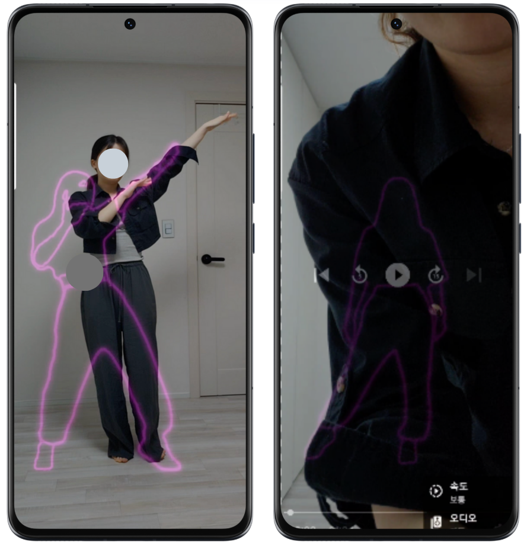
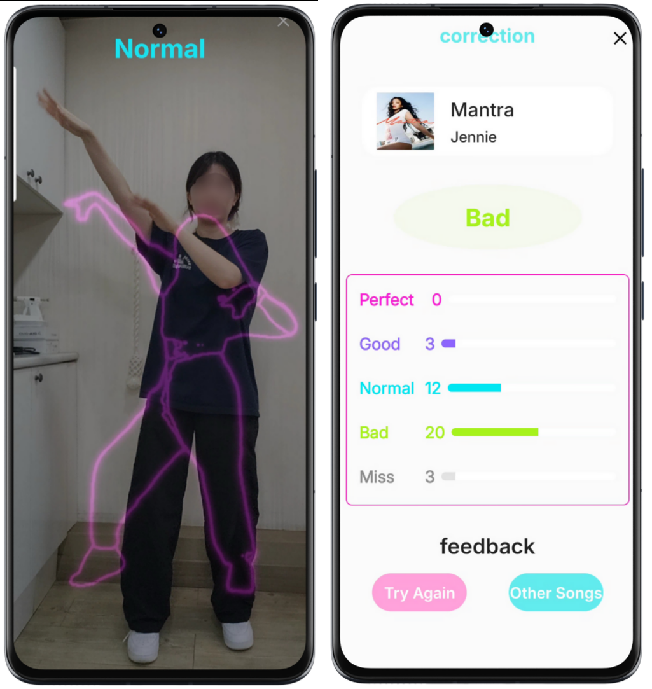
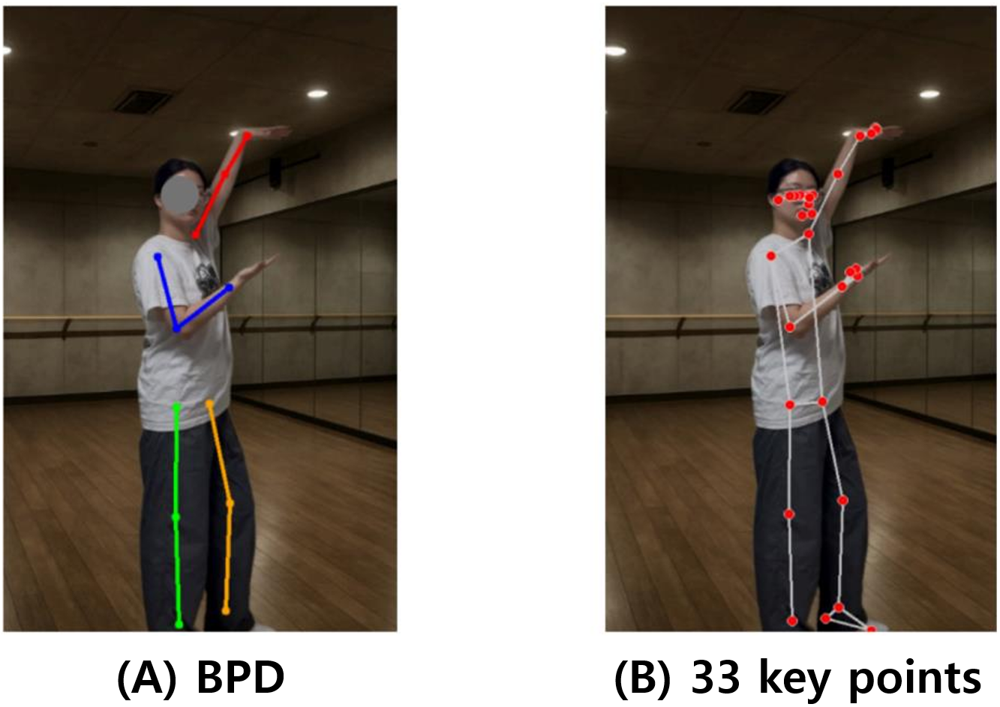
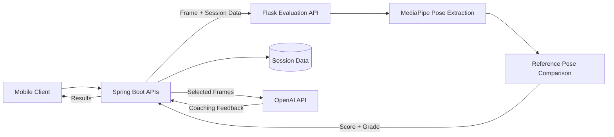

# Danzle — AI Pose Evaluation & Backend 💃

> **AI 기반 K-pop 안무 학습 및 맞춤형 피드백 서비스**  
> **팀 프로젝트 | Java · Spring Boot · Python · Flask · MediaPipe**

## 1. 프로젝트 개요

Danzle은 혼자 K-pop 안무를 연습하는 사용자가 자신의 동작을 전문가 동작과 비교할 수 있도록, **동작 유사도 점수**와 **GPT 기반 교정 피드백**을 제공하는 학습 서비스입니다.

이 저장소는 전체 팀 프로젝트 중 **직접 참여한 백엔드 및 AI 동작 평가 기능**을 중심으로 선별한 포트폴리오용 코드입니다.

## 2. 담당 역할


**Backend Development & AI Pose Evaluation**

- Spring Boot 기반 사용자 인증, 연습·평가 세션 생성 및 조회 REST API 개발
- Spring Data JPA를 활용한 평가 세션 및 프레임별 분석 결과 저장·조회 기능 구현
- Spring Boot와 Flask 간 REST API 연동을 통한 AI 분석 요청 및 결과 처리
- MediaPipe 기반 신체 관절 데이터 추출 및 동작 유사도 평가 로직 구현
- All Keypoints와 신체 부위별 방향·각도 기반 평가 방식 비교
- GPT API 기반 맞춤형 교정 피드백 연동 개발 참여
- 클라이언트·서버 프레임 동기화와 서버 처리 개선 과정 협업

> 팀원이 담당한 프론트엔드 및 AWS 인프라 구축·배포는 개인 개발 성과에 포함하지 않았음

## 3. 기술 스택

| 영역 | 기술 | 활용 내용 |
| --- | --- | --- |
| Backend | Java 21, Spring Boot, Spring Security, Spring Data JPA | REST API, 인증, 데이터 처리 |
| AI Evaluation | Python, Flask, MediaPipe, OpenCV, NumPy | 관절 좌표 추출, 동작 비교, 평가 API |
| AI Feedback | OpenAI API | 사용자·전문가 프레임 기반 교정 피드백 |
| Data / Integration | MySQL, Redis, AWS S3, REST API | 세션 저장, 인증 보조, 이미지 처리, 서버 연동 |

> DB·스토리지·인프라 기술은 **팀 전체 서비스 구성**을 설명하기 위한 것으로 인프라 구축 및 배포의 개인 기여를 뜻하지 않음

## 4. 주요 기능 및 화면

### 4.1 실시간 안무 연습

전문가 실루엣 가이드를 사용자 카메라 화면에 함께 표시하여 동작을 비교하며 연습하도록 구성했습니다. 화면 구현은 팀 공동 결과물입니다.



### 4.2 동작 정확도 평가 및 결과 요약

사용자 동작을 평가해 등급으로 제공하고, 세션 종료 후 등급별 결과를 요약합니다.



### 4.3 평가 방식 비교

실험에서 **All Keypoints**(33개 관절 좌표)와 **BPD**(주요 신체 부위의 벡터 기반 비교)를 비교했습니다. 프로젝트 정리 문서에서는 BPD가 유사 동작과 오류 동작을 상대적으로 더 일관되게 구분하여 최종 평가 방식으로 선정되었다고 기록했습니다.



> 위 평가는 프로젝트 과정의 실험 설명임. 현재 공개한 [`pose.py`](flask_server/pose.py)는 어깨 방향, 관절 각도 및 부위별 좌표 차이를 조합하는 `compare_pose_directional()` 로직을 포함함

## 5. 핵심 구현 및 데이터 흐름



### AI 동작 평가

- [`flask_server/pose.py`](flask_server/pose.py) — 관절 좌표 추출·정규화, 방향·부위별 좌표 차이 및 각도 기반 점수 계산
- [`flask_server/flask_pose_eval.py`](flask_server/flask_pose_eval.py) — `POST /analyze` 평가 API, `GET /health` 상태 확인


### 백엔드 API 및 세션 관리

Java와 Spring Boot를 활용해 사용자 인증, 연습·평가 세션 관리, 분석 결과 저장 및 조회를 위한 REST API를 구현했습니다.

- **사용자 인증:** Spring Security와 JWT·Refresh Token을 활용한 인증 및 토큰 재발급 처리
- **세션 관리:** 사용자와 곡 정보를 기반으로 연습·평가 세션을 생성하고, Spring Data JPA를 통해 기록 저장 및 조회
- **서버 간 통신:** Spring Boot에서 이미지 프레임과 세션 정보를 Flask의 `/analyze` API로 전달하고, 분석 결과를 수신
- **평가 결과 저장:** 프레임별 점수와 평가 등급을 DB에 저장하고, 세션 종료 시 평균 점수를 계산
- **예외 처리:** 잘못된 요청, 존재하지 않는 세션, 서버 오류에 따라 HTTP 상태 코드(400, 404, 500)와 오류 응답을 구분

**주요 REST API**

| Method | Endpoint | 기능 |
| --- | --- | --- |
| POST | `/join` | 사용자 회원가입 |
| POST | `/refresh` | Access Token 재발급 |
| POST | `/accuracy-session/full` | 동작 평가 세션 생성 |
| POST | `/accuracy-session/analyze` | 이미지 프레임 분석 및 결과 저장 |
| GET | `/accuracy-session/result` | 세션별 상세 평가 결과 조회 |
| GET | `/accuracy-session/summary` | 세션 평가 결과 요약 조회 |

**관련 코드**

- [`AuthController.java`](spring_server/src/main/java/capston/capston_spring/controller/AuthController.java) — 사용자 인증 및 토큰 재발급
- [`AccuracySessionController.java`](spring_server/src/main/java/capston/capston_spring/controller/AccuracySessionController.java) — 평가 세션 REST API
- [`AccuracySessionService.java`](spring_server/src/main/java/capston/capston_spring/service/AccuracySessionService.java) — 분석 요청, 결과 저장 및 세션 관리
- [`JWTUtil.java`](spring_server/src/main/java/capston/capston_spring/jwt/JWTUtil.java) — JWT 생성 및 검증

### GPT 교정 피드백

- [`AiFeedbackController.java`](spring_server/src/main/java/capston/capston_spring/controller/AiFeedbackController.java) / [`OpenAiService.java`](spring_server/src/main/java/capston/capston_spring/service/OpenAiService.java)
- 현재 공개한 `AccuracySessionService.java`는 **최저 점수 3개 프레임**을 조회해 관련 이미지를 바탕으로 GPT 피드백을 요청합니다(`findTop3BySessionOrderByScoreAsc`). 피드백은 저장 후 API 응답에 포함됩니다.

## 6. 문제 해결 및 개선

### 6.1 빠른 안무에서 발생하는 점수 불안정성 개선 — 별도 실험 결과

| 구분 | 내용 |
| --- | --- |
| **Problem** | Single Frame 방식에서는 빠르게 자세가 바뀌는 순간 점수가 급격히 변동 |
| **Action** | 현재 프레임과 0.5초 전 프레임을 함께 비교하는 Double Frame 방식을 별도로 실험하고, 동일 안무 데이터에서 평가 점수의 일관성을 비교했음 |
| **Result** | 점수 표준편차가 **4.93 → 3.33**으로 개선됨(약 **32.5% 감소**). |


> **실험 코드와 현재 저장소 코드의 범위는 다름.** 위 Double Frame 결과는 프로젝트 과정에서 수행한 별도 실험임. 현재 업로드한 `pose.py`에는 단일 프레임 기반 `compare_pose_directional()`이 들어 있음

### 6.2 클라이언트·서버 간 프레임 동기화 개선

| 구분 | 내용 |
| --- | --- |
| **Problem** | 초기에는 서버 시간을 기준으로 사용자 프레임과 전문가 데이터를 비교했음. 이 과정에서 네트워크 전송 및 서버 처리 지연으로 서로 다른 시점의 동작이 비교되어 평가 정확도가 떨어지는 문제가 발생 |
| **Action** | 프론트엔드 담당 팀원과 의하여 클라이언트가 평가 요청 시 해당 시점의 시간 정보를 함께 전달하도록 변경했음. Spring Boot에서는 전달받은 초 단위 정보를 30fps 기준 프레임 인덱스로 변환해 Flask 서버에 전달하도록 구현 |
| **Result** | 클라이언트가 전달한 시점을 기준으로 사용자 동작과 전문가 데이터를 매칭하여, 전송 지연에 따른 평가 시점 불일치를 개선 |

**관련 코드**

- [`AccuracySessionController.java`](spring_server/src/main/java/capston/capston_spring/controller/AccuracySessionController.java)
- [`AccuracySessionService.java`](spring_server/src/main/java/capston/capston_spring/service/AccuracySessionService.java)

### 6.3 실시간 AI 분석 과정의 서버 부하 개선

| 구분 | 내용 |
| --- | --- |
| **Problem** | 초기 구현에서 0.5초 간격으로 수행되는 MediaPipe 분석 및 GPT 호출 때문에 연산 부하가 누적됨. 이 과정에서 정확도 모드를 반복 실행하면 서버가 비정상적으로 종료되는 문제가 발생 |
| **Action** | 팀원들과 분석 요청 주기를 0.5초에서 1초로 변경하고, 서버의 연산 및 요청 처리 흐름을 개선 |
| **Result** | 프로젝트 실행 과정에서 CPU 사용률이 기존 대비 **약 50%** 감소. 반복 실행 시 발생하던 서버 과부하 문제 역시 완화됨. |

> CPU 사용률 개선 수치는 프로젝트 실행 과정에서 관찰한 결과이며, 별도의 정식 부하 테스트 결과는 아님.

## 7. 프로젝트 구조

```text
Danzle-AI-Backend/
├── flask_server/
│   ├── pose.py                # Keypoints, normalization, scoring
│   ├── flask_pose_eval.py     # Pose evaluation API
│   └── requirements.txt
├── spring_server/
│   ├── build.gradle
│   ├── settings.gradle
│   └── src/
│       ├── main/java/capston/capston_spring/
│       │   ├── controller/    # REST API
│       │   ├── service/       # Business logic
│       │   ├── repository/    # Database access
│       │   ├── entity/        # Domain models
│       │   ├── dto/           # Request/response models
│       │   ├── jwt/           # Authentication
│       │   └── config/        # App configuration
│       └── test/java/
└── docs/screenshots/          # 서비스 및 실험 이미지
```

## 8. 프로젝트 구성 및 실행 안내

이 저장소는 **Danzle 프로젝트에서 개발한 AI 동작 평가 및 백엔드 구현을 중심으로 정리한 포트폴리오**입니다.

- 환경별 설정 파일(`.env`, `application.properties`)은 공개 범위에서 제외했습니다.
- 기준 안무 데이터(`ref_poses`), 배포 인프라 설정 및 클라이언트 코드는 포함하지 않았습니다.
- 전체 서비스를 실행하려면 데이터베이스, 스토리지, 외부 API 연동 및 기준 데이터 설정이 필요합니다.
- 스크린샷과 실험 그래프는 실제 프로젝트 개발 및 성능 평가 과정에서 확보한 자료입니다.

**Project type:** Team project · **Portfolio focus:** Spring Boot backend + AI pose evaluation
