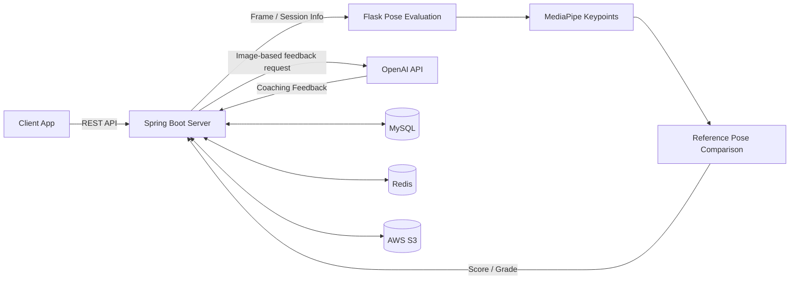

# DANZLE — AI Pose Evaluation & Spring Boot Backend

> **AI 기반 K-pop 안무 학습 및 동작 평가 서비스**  
> Java/Spring Boot 백엔드와 Python/Flask 기반 동작 평가 기능을 결합한 팀 프로젝트입니다.

## 1. Project Overview

DANZLE은 사용자의 안무 동작을 전문가의 기준 동작과 비교해 **자세 유사도를 점수로 제공**하고, 개선이 필요한 구간에 **GPT 기반 교정 피드백**을 제공하는 서비스입니다.

본 저장소는 팀 프로젝트 중 **백엔드 및 AI 동작 평가 구현 경험**을 중심으로 정리한 포트폴리오용 코드입니다.

### 주요 기능

- **동작 평가:** MediaPipe로 신체 관절 좌표를 추출하고 기준 동작과 비교하여 점수 산출
- **맞춤형 피드백:** 낮은 점수를 받은 구간의 사용자·전문가 이미지를 기반으로 GPT 피드백 요청
- **학습 세션 관리:** 연습/평가 세션 생성, 결과 저장 및 조회
- **사용자·인증 관리:** 회원 관리 API, JWT 및 Refresh Token 처리

## 2. Tech Stack

| 영역 | 기술 |
| --- | --- |
| Backend | Java 21, Spring Boot, Spring Security, Spring Data JPA, Gradle |
| AI / Pose Evaluation | Python, Flask, MediaPipe, OpenCV, NumPy |
| AI Feedback | OpenAI API (GPT 기반 이미지 비교 피드백) |
| Data / Integration | MySQL, Redis, AWS S3, REST API |

> MySQL·Redis·AWS S3는 팀 전체 시스템에서 활용한 기술입니다. 인프라 구축·배포는 다른 팀원이 담당했으며, 개인 개발 성과로 기재하지 않았습니다.

## 3. My Contributions

### Backend Development

- Spring Boot 기반 사용자 관리 및 학습 세션 관련 REST API 개발
- JWT·Refresh Token 기반 인증 기능 구현
- 평가 결과 저장·조회 및 Flask 평가 서버와의 데이터 연동 작업

### AI Pose Evaluation

- MediaPipe를 활용한 사용자 프레임의 신체 관절 좌표 추출
- 관절 좌표 정규화 및 사용자·전문가 자세 비교 로직 구현
- 방향·신체 부위별 좌표 차이·관절 각도 차이를 조합한 동작 점수 계산
- Flask API를 통해 평가 요청을 받고 점수 및 등급을 JSON으로 반환하는 흐름 구현

### Collaboration

- GPT 기반 교정 피드백 기능 연동에 참여
- 프레임 동기화 및 서버 처리 성능 개선 과정에 협업

> 일부 기능은 팀원과 공동 개발했습니다. 이 문서는 개인 기여 내용과 전체 서비스 기능을 구분하여 설명합니다. 소셜 로그인 및 인프라 등 담당 범위가 확실하지 않은 기능은 개인 단독 성과로 표기하지 않았습니다.

## 4. System Architecture



**처리 흐름:** 사용자 프레임 수신 → 기준 동작과 비교 → 점수 및 등급 산출 → 학습 세션 결과 저장 → 개선이 필요한 구간에 대한 GPT 피드백 요청.

## 5. Core Implementation

### 5.1 AI Pose Evaluation — Python / Flask

**[pose.py](flask_server/pose.py)**

1. MediaPipe에서 어깨, 팔꿈치, 손목, 골반, 무릎, 발목의 관절 좌표를 추출합니다.
2. 양쪽 골반의 중점을 원점으로 잡고 좌표를 정규화하여 신체 위치·크기에 따른 차이를 줄입니다.
3. 어깨 방향, 신체 부위별 좌표 차이, 관절 각도 차이를 계산합니다.
4. 항목별 점수를 가중 평균하여 최종 자세 점수를 산출합니다.

**[flask_pose_eval.py](flask_server/flask_pose_eval.py)**

- `POST /analyze`: 이미지 프레임과 곡·프레임 정보를 입력받아 자세 점수와 피드백 등급 반환
- `POST /save`: Pose detector 종료 및 메모리 정리
- `GET /health`: 서버 상태 조회
- 전문가 기준 관절 데이터는 곡 단위로 메모리에 캐시하여 반복 조회합니다.

> 현재 업로드한 코드에는 **단일 프레임 기반 `compare_pose_directional()`** 평가가 구현되어 있습니다. 실험 과정에서 검토한 별도의 Double Frame 방식은 현재 코드에 포함되어 있지 않아 이 저장소의 구현 기능으로 표기하지 않았습니다.

### 5.2 Spring Boot APIs & Session Management

- **[AuthController.java](spring_server/src/main/java/capston/capston_spring/controller/AuthController.java)** — 회원가입·토큰 재발급
- **[PracticeSessionController.java](spring_server/src/main/java/capston/capston_spring/controller/PracticeSessionController.java)** — 연습 세션 생성·조회·저장
- **[AccuracySessionController.java](spring_server/src/main/java/capston/capston_spring/controller/AccuracySessionController.java)** — 동작 평가 요청 및 결과 조회
- **[AccuracySessionService.java](spring_server/src/main/java/capston/capston_spring/service/AccuracySessionService.java)** — Flask 연동, 프레임별 평가 결과 및 세션 처리
- **[JWTUtil.java](spring_server/src/main/java/capston/capston_spring/jwt/JWTUtil.java)** — 토큰 발급·검증 관련 유틸리티

### 5.3 GPT-based Coaching Feedback

**[AiFeedbackController.java](spring_server/src/main/java/capston/capston_spring/controller/AiFeedbackController.java)** 및 **[OpenAiService.java](spring_server/src/main/java/capston/capston_spring/service/OpenAiService.java)**

- 평가 세션에서 점수가 낮은 구간을 찾아 피드백 요청
- 사용자 동작 및 전문가 기준 이미지의 데이터를 읽어 GPT 이미지 입력으로 전달
- 팔·다리·상체 방향 등 **동작 차이와 개선 방법에 집중하도록 프롬프트를 구성**
- 생성된 피드백을 API 응답으로 반환

## 6. Project Structure

```text
Danzle-AI-Backend/
├── flask_server/
│   ├── pose.py                  # Keypoint extraction & pose scoring
│   ├── flask_pose_eval.py       # Pose evaluation API
│   └── requirements.txt
├── spring_server/
│   ├── build.gradle
│   ├── settings.gradle
│   └── src/
│       ├── main/java/capston/capston_spring/
│       │   ├── controller/      # REST API endpoints
│       │   ├── service/         # Business logic & integrations
│       │   ├── repository/      # Data access
│       │   ├── entity/          # Domain entities
│       │   ├── dto/             # Request/response objects
│       │   ├── jwt/             # Token authentication
│       │   └── config/          # Application configuration
│       └── test/java/
└── README.md
```

## 7. Portfolio Version & Execution Notes

이 저장소는 **공개 가능한 핵심 소스코드를 정리한 포트폴리오 버전**입니다. 팀 프로젝트 원본을 그대로 배포한 것이 아닙니다.

- API 키, 비밀번호 등 인증 정보가 담길 수 있는 `.env` 및 `application.properties`를 제외했습니다.
- 전문가 기준 안무 데이터(`ref_poses`)와 팀 배포용 인프라 설정은 포함하지 않았습니다.
- 따라서 이 저장소만 내려받아서는 **전체 서비스를 즉시 실행할 수 없습니다.** 실제 실행에는 별도의 환경 설정, DB, 외부 서비스 및 기준 데이터가 필요합니다.
- 보안상 비밀값은 소스코드에 포함하지 않습니다.

---

**Project type:** Team project · **Focus:** Backend development + AI pose evaluation · **Purpose:** Technical portfolio
