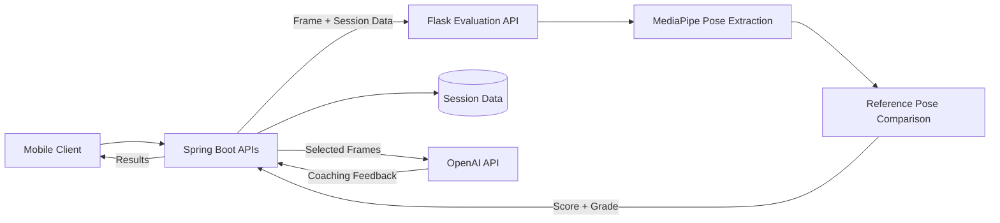
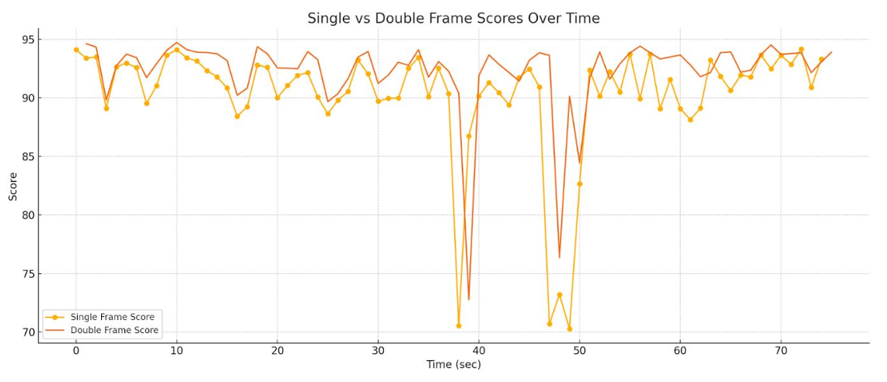

# Danzle — AI Pose Evaluation & Backend 💃

> **AI 기반 K-pop 안무 학습 및 맞춤형 피드백 서비스**  
> **팀 프로젝트 | Java · Spring Boot · Python · Flask · MediaPipe**

## 1. 프로젝트 개요

Danzle은 혼자 K-pop 안무를 연습하는 사용자가 자신의 동작을 전문가 동작과 비교할 수 있도록, **동작 유사도 점수**와 **GPT 기반 교정 피드백**을 제공하는 학습 서비스입니다.

이 저장소는 전체 팀 프로젝트 중 **직접 참여한 백엔드 및 AI 동작 평가 기능**을 중심으로 선별한 포트폴리오용 코드입니다.

## 2. 담당 역할

**Backend Development & AI Service Integration**

- Spring Boot 기반 사용자 정보 및 연습·평가 세션 관련 REST API 개발
- JWT·Refresh Token 기반 사용자 인증 및 분석 결과 저장·조회 기능 개발
- MediaPipe 기반 신체 관절 데이터 추출 및 동작 유사도 평가 로직 구현
- All Keypoints와 신체 부위별 방향·각도 기반 평가 방식 비교
- GPT API 기반 맞춤형 교정 피드백 연동 개발 참여
- 클라이언트·서버 프레임 동기화와 서버 처리 개선 과정 협업

> 팀원이 담당한 프론트엔드 및 AWS 인프라 구축·배포는 개인 개발 성과에 포함하지 않았습니다.

## 3. 기술 스택

| 영역 | 기술 | 활용 내용 |
| --- | --- | --- |
| Backend | Java 21, Spring Boot, Spring Security, Spring Data JPA | REST API, 인증, 데이터 처리 |
| AI Evaluation | Python, Flask, MediaPipe, OpenCV, NumPy | 관절 좌표 추출, 동작 비교, 평가 API |
| AI Feedback | OpenAI API | 사용자·전문가 프레임 기반 교정 피드백 |
| Data / Integration | MySQL, Redis, AWS S3, REST API | 세션 저장, 인증 보조, 이미지 처리, 서버 연동 |

> DB·스토리지·인프라 기술은 **팀 전체 서비스 구성**을 설명하기 위한 것으로, 인프라 구축 및 배포의 개인 기여를 뜻하지 않습니다.

## 4. 주요 기능 및 화면

### 4.1 실시간 안무 연습

전문가 실루엣 가이드를 사용자 카메라 화면에 함께 표시하여 동작을 비교하며 연습하도록 구성했습니다. 화면 구현은 팀 공동 결과물입니다.


### 4.2 동작 정확도 평가 및 결과 요약

사용자 동작을 평가해 등급으로 제공하고, 세션 종료 후 등급별 결과를 요약합니다.


### 4.3 평가 방식 비교

실험에서 **All Keypoints(33개 관절 좌표)**와 **BPD(주요 신체 부위의 벡터 기반 비교)**를 비교했습니다. 프로젝트 정리 문서에서는 BPD가 유사 동작과 오류 동작을 상대적으로 더 일관되게 구분하여 최종 평가 방식으로 선정되었다고 기록했습니다.


> 위 평가는 프로젝트 과정의 실험 설명입니다. 현재 공개한 [`pose.py`](flask_server/pose.py)는 어깨 방향, 관절 각도 및 부위별 좌표 차이를 조합하는 `compare_pose_directional()` 로직을 포함합니다.

## 5. 핵심 구현 및 데이터 흐름



**AI 동작 평가**

- [`flask_server/pose.py`](flask_server/pose.py) — 관절 좌표 추출·정규화, 방향·부위별 좌표 차이 및 각도 기반 점수 계산
- [`flask_server/flask_pose_eval.py`](flask_server/flask_pose_eval.py) — `POST /analyze` 평가 API, `GET /health` 상태 확인

**백엔드 API 및 세션 관리**

- [`AuthController.java`](spring_server/src/main/java/capston/capston_spring/controller/AuthController.java) — 회원가입, Refresh Token 처리
- [`AccuracySessionController.java`](spring_server/src/main/java/capston/capston_spring/controller/AccuracySessionController.java) — 평가 세션 API
- [`AccuracySessionService.java`](spring_server/src/main/java/capston/capston_spring/service/AccuracySessionService.java) — 프레임 평가·저장 및 Flask/GPT 연동
- [`JWTUtil.java`](spring_server/src/main/java/capston/capston_spring/jwt/JWTUtil.java) — 토큰 생성·검증

**GPT 교정 피드백**

- [`AiFeedbackController.java`](spring_server/src/main/java/capston/capston_spring/controller/AiFeedbackController.java) / [`OpenAiService.java`](spring_server/src/main/java/capston/capston_spring/service/OpenAiService.java)
- 현재 공개한 `AccuracySessionService.java`는 **최저 점수 3개 프레임**을 조회해 관련 이미지를 바탕으로 GPT 피드백을 요청합니다(`findTop3BySessionOrderByScoreAsc`). 피드백은 저장 후 API 응답에 포함됩니다.

## 6. 문제 해결 및 개선

### 빠른 안무에서 발생하는 점수 불안정성 개선 — 별도 실험 결과

| 구분 | 내용 |
| --- | --- |
| **Problem** | Single Frame 방식에서는 빠르게 자세가 바뀌는 순간 점수가 급격히 떨어졌습니다. |
| **Action** | 현재 프레임과 0.5초 전 프레임을 함께 비교하는 Double Frame 방식을 별도로 실험하고, 동일 안무 데이터의 점수 변화를 비교했습니다. |
| **Result** | 점수 표준편차가 **4.93 → 3.33(약 32.5% 감소)**으로 개선되었습니다. |



> **실험 코드와 현재 저장소 코드의 범위는 다릅니다.** 위 Double Frame 결과는 프로젝트 과정에서 수행한 실험에 해당하며, 현재 업로드한 `pose.py`에는 단일 프레임 기반 `compare_pose_directional()`이 들어 있습니다. 따라서 해당 실험을 이 저장소의 재현 가능한 구현으로 주장하지 않습니다.

## 7. 프로젝트 구조

```text
Danzle-AI-Backend/
├── flask_server/
│   ├── pose.py                # Keypoints, normalization, scoring
│   ├── flask_pose_eval.py     # Pose evaluation API
│   └── requirements.txt
├── spring_server/
│   ├── build.gradle
│   ├── settings.gradle
│   └── src/
│       ├── main/java/capston/capston_spring/
│       │   ├── controller/    # REST API
│       │   ├── service/       # Business logic
│       │   ├── repository/    # Database access
│       │   ├── entity/        # Domain models
│       │   ├── dto/           # Request/response models
│       │   ├── jwt/           # Authentication
│       │   └── config/        # App configuration
│       └── test/java/
└── docs/screenshots/          # 서비스 및 실험 이미지
```

## 8. 실행 및 참고 사항

**이 저장소는 포트폴리오용 핵심 구현 자료로, 전체 서비스 실행 패키지는 아닙니다.**

- 비밀 정보가 포함될 수 있는 `.env` 및 `application.properties`는 제외했습니다.
- 기준 안무 데이터(`ref_poses`)와 인프라 설정·전체 클라이언트 코드는 포함하지 않았습니다.
- 전체 서비스 실행을 위해서는 별도의 DB, 스토리지, 인증 정보, 기준 데이터 및 환경 구성이 필요합니다.
- 스크린샷과 실험 그래프는 프로젝트 문서에서 추출한 자료이며, 실제 서비스 개발과 실험 과정을 설명합니다.

**Project type:** Team project · **Portfolio focus:** Spring Boot backend + AI pose evaluation
